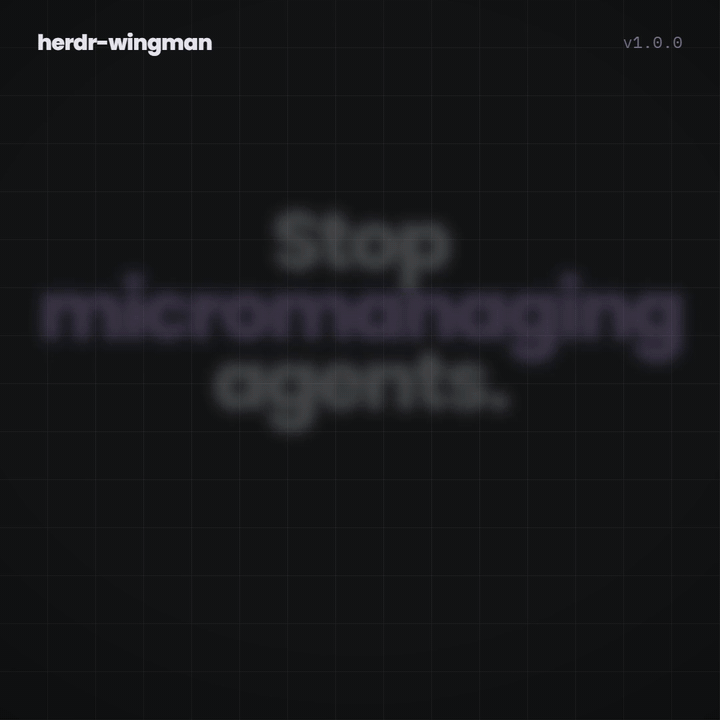

<p align="center"></p>

<h3 align="center">One Coordinator, many agents, nothing you have to keep in your head</h3>

<p align="center">Herdr Wingman is mission control for <a href="https://herdr.dev">Herdr</a>: one task list for the work you keep and the work you delegate. You type what needs doing and the board's Coordinator turns it into tasks. Each task runs as an ordinary Herdr agent in its own space and git worktree, is checked and reviewed by a second agent, and waits for your yes before it merges. The board shows what needs you, what is ready to approve, and what is still working.</p>

<p align="center"></p>

<p align="center"><a href="https://github.com/striderZA/herdr-wingman/blob/master/docs/get-started.md"></a></p>

<p align="center"><sub>✓&nbsp;MIT&nbsp;licensed &nbsp; ✓&nbsp;Runs&nbsp;on&nbsp;your&nbsp;machine,&nbsp;no&nbsp;hosted&nbsp;service &nbsp; ✓&nbsp;Linux&nbsp;and&nbsp;Windows,&nbsp;Herdr&nbsp;0.9.3+&nbsp;(0.9.4+&nbsp;on&nbsp;Windows)</sub></p>

## What the board does

The board is the overview and the remote control; Herdr is the engine.

- **One list, in the order that matters.** Tasks sit in five groups, `needs you`, `ready to approve`, `working`, `to do` and `done`, with a filter row that counts them. Each row names its agent, state, review round, pull request and time left. Herdr's sidebar carries the live rows too.
- **Each task gets its own agent.** The Coordinator turns what you type into one task or several; every one starts on Claude Code, Codex, pi or [another agent Herdr supports](docs/agents.md), on its own branch in its own worktree, with the task and the board's rules. Your checkout is never touched.
- **Nothing merges unseen.** A finish commits the work, merges main in, runs the repo's check, opens a draft pull request and has a second agent review it. A failed check or review goes back to the agent; passing work waits for your `Ctrl+L`. A small keeper does the same with the board closed.

Want more control? Ask for [a plan first](docs/plan.md), [several attempts and one kept](docs/attempts.md), [limits](docs/limits.md) on time and tokens, or [automations](docs/automations.md) that add tasks on a schedule.

## How it compares

| | **Herdr Wingman** | Briefing agents by hand | One long agent session | Cloud projects products |
|---|:---:|:---:|:---:|:---:|
| **Parallel tasks on separate branches** | ✅ | ✅ | ❌ | ✅ |
| **Same rules for every agent** | ✅ | ❌ | ✅ | ✅ |
| **A second agent reviews every finished task** | ✅ | ❌ | ❌ | ❌ |
| **Branches kept up to date with main** | ✅ | ❌ | ❌ | ❌ |
| **Tasks grouped by what needs you** | ✅ | ❌ | ❌ | ✅ |
| **Works with the agent CLI you already use** | ✅ | ✅ | ✅ | ❌ |
| **Runs on your own machine** | ✅ | ✅ | ✅ | ❌ |
| **Runs with no machine of yours switched on** | ❌ | ❌ | ❌ | ✅ |

## Open the board in three steps

<table>
<tr>
<td align="center" valign="top" width="33%"><h3>1️⃣</h3><b>Install the plugin</b><br /><sub>Run <code>herdr plugin install striderZA/herdr-wingman</code>. It downloads one program for your platform: no Node, no npm.</sub></td>
<td align="center" valign="top" width="33%"><h3>2️⃣</h3><b>Open the board</b><br /><sub>Run the plugin's action "Open the work board", or <code>herdr plugin action invoke open --plugin herdr-wingman</code> (<code>open-windows</code> on Windows). Its first screen offers a key that opens it from anywhere in Herdr.</sub></td>
<td align="center" valign="top" width="33%"><h3>3️⃣</h3><b>Type what needs doing</b><br /><sub><code>Enter</code> has the Coordinator make it a task, <code>Ctrl+S</code> puts an agent on the one you select, and <code>?</code> shows everything else.</sub></td>
</tr>
</table>

[Getting started](docs/get-started.md) has the same steps with the details; [installing](docs/install.md) covers prerequisites, building from source and uninstalling.

## Updating

```bash
herdr-wingman update           # put the newest release in place of the program
herdr-wingman update 1.0.0     # a given version
```

An open board and the keeper load the new program by themselves, once nothing is half typed and no agent is held up. A program you built yourself is updated with `git pull` and `cargo build --release`.

## Questions

**Do I need to know how to code?** You need a terminal. Everything changes by asking the Coordinator or from the settings page (`Ctrl+E`); you never edit the program's files. You need Linux or Windows, Herdr 0.9.3+ (0.9.4+ on Windows), git, `curl` or `wget`, and an agent CLI. `gh` is optional; Rust only if you build it yourself. [Installing](docs/install.md) lists it all.

**What permissions do the agents get?** Full access by default, so a task never waits on a prompt nobody sees: `claude --dangerously-skip-permissions`, `codex --dangerously-bypass-approvals-and-sandbox`. They can do anything you can; the rules and the review are guidance, not a sandbox. Set `worker.access ask` (and `reviewer.access`, `coordinator.access`) to be asked first. Your own agent settings and hooks are untouched.

**Will it touch my branches or my checkout?** Only what it made. Each task has a worktree and a branch named from its title (`feat/12-add-a-greeting`; `workspace.branch` changes the pattern). The board merges main into those branches, rolls a real conflict back to the task's agent, and merges only on your yes, at the commit that was reviewed. Finished tasks are cleaned up; unsaved or unmerged work stays on disk. [How work gets done](docs/how-work-gets-done.md) has the details.

**Does it send my work to a hosted service?** No. The board keeps its files in `~/.herdr-wingman/` on your machine and talks to your local Herdr. Your agent CLI still uses its own service as usual. [The home folder](docs/home-folder.md) lists every file.

**Is that enough safety?** The guards are soft: nothing merges without your yes, a failed review can't be merged by a plain yes, and a repo's own file can't switch off the review. Agents still have a shell. Turn on `worker.access ask`, [a plan first](docs/plan.md) and [limits](docs/limits.md) for more.


## Why this fork

Herdr Wingman is a fork of [Shepherdr](https://github.com/eliasstravik/shepherdr) by Elias Stravik, and like it MIT licensed. Shepherdr grew into a Herdr app with a web board, voice calls, Autopilot and sync between machines. This fork keeps the task board, for one machine:

- **One job, done well.** One list on one machine, an agent per task in its own worktree, a check and a review before anything merges, and your yes.
- **Linux and Windows.** Both are built and tested here. macOS is unsupported: there is no Mac to test on.

Thanks to Elias Stravik for the board this fork is built on.
